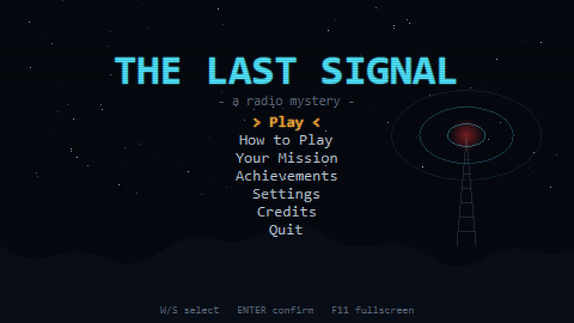
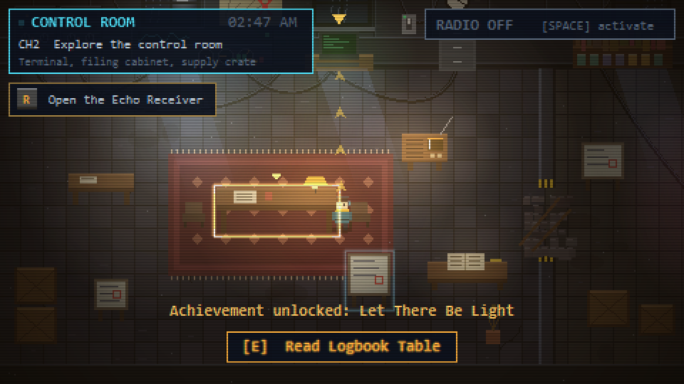
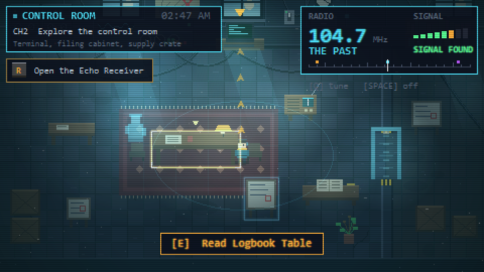
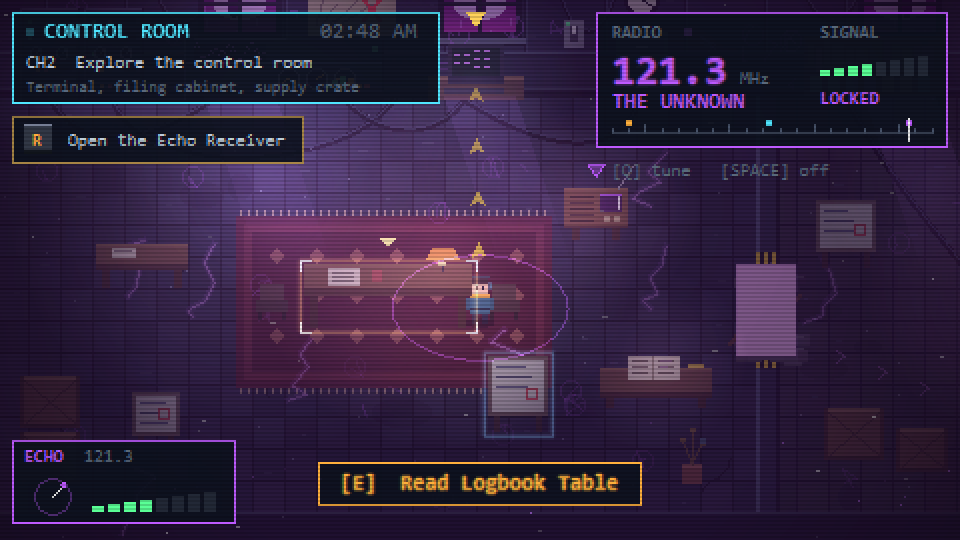
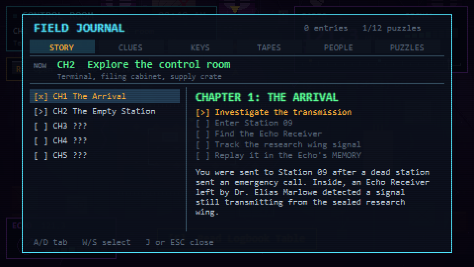
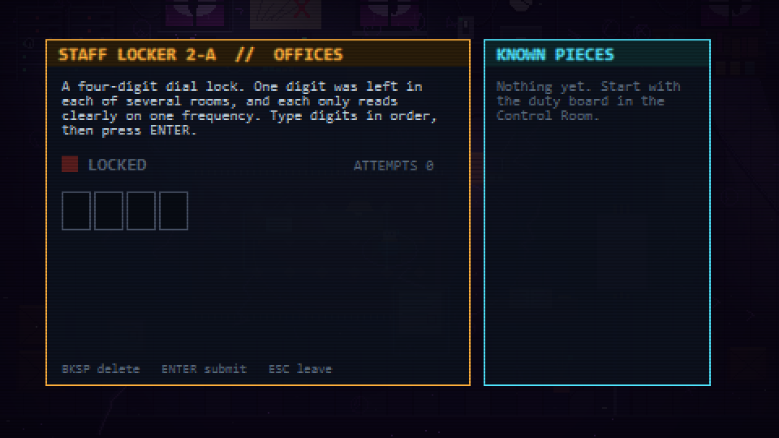
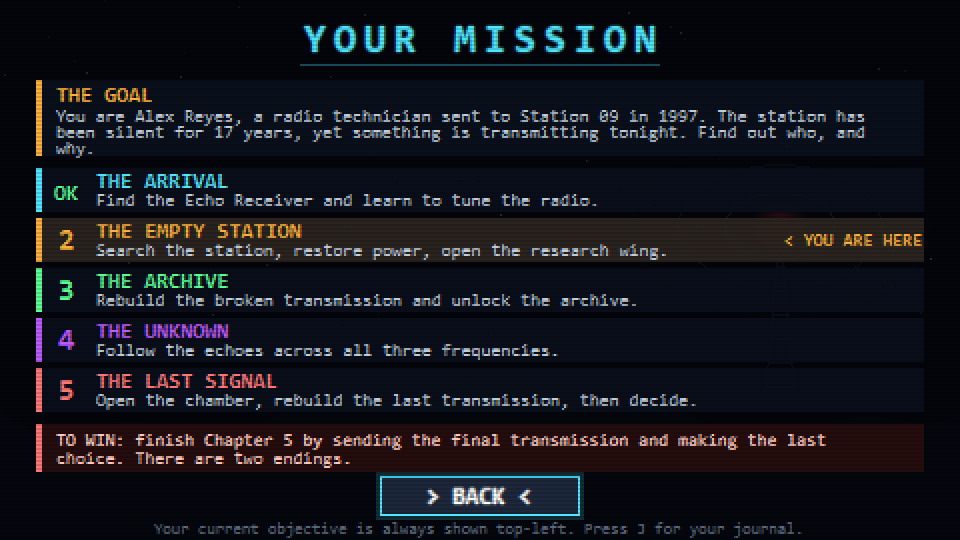
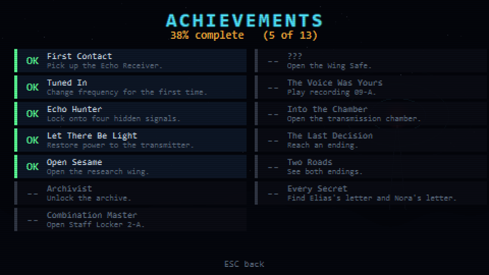

# THE LAST SIGNAL

A 2D pixel-art radio-mystery adventure written in Python with PyQt6 and QPainter. All graphics and audio are generated procedurally, so there are no asset files.

You are Alex Reyes, a radio technician sent to the abandoned Station 09 in August 1997. The station has been silent for 17 years, yet something is transmitting tonight. Tune between three frequencies (88.1 Present, 104.7 Past, 121.3 Unknown), use the Echo Receiver, solve puzzles across five chapters, and choose how the story ends (two endings).

## Run

Windows, no Python needed: download `TheLastSignal.exe` from the [latest release](https://github.com/Kiwmoj/the-last-signal/releases/latest) and run it.

## Screenshots

| | |
| --- | --- |
|  |  |
|  |  |
|  |  |
|  |  |

From source:

```
pip install PyQt6
python main.py
```

Requires Python 3.10+.

## Controls (all rebindable in Settings > Controls)

| Key | Action |
| --- | --- |
| WASD / arrows | Move |
| E | Interact |
| SPACE | Radio on/off |
| Q | Change frequency |
| R | Echo Receiver |
| J | Journal |
| K | Hint (press again for more specific hints) |
| H | Guide arrows on/off |
| F | Flashlight |
| ESC | Pause |
| F10 / F12 | Hide HUD / save a screenshot to `screenshots/` |

Gamepad (Xbox-compatible, Windows): stick or D-pad moves, A interact, B or Start pause, X radio, LB tune, RB Echo, Y journal, Back hint.

## Features

- Five connected chapters, two endings, journal, achievements, three save slots.
- Gold guide arrows lead to the current objective.
- Optional code puzzles: Staff Locker 2-A and the Wing Safe, with digits spread across rooms and frequencies.
- Procedural soundtrack with six moods that change by room and frequency.

## Custom music

The soundtrack is generated the first time you play (about 20 seconds, in the background). To use your own music, put WAV files named `menu`, `control`, `explore`, `unknown`, `revelation` or `chapter` in a `music/` folder, for example `music/menu.wav`.

## Play in a web browser

```
python web.py
```

Then open http://localhost:8080. The game keeps running in Python/PyQt on your computer and is streamed to the browser, which sends your keys and clicks back. Use `--host 0.0.0.0 --port 9000` to let other devices on your network connect. Limits: one shared game session for everyone connected, and no sound in the browser. To put it online for the public you need a host that can run Python 24/7 (a small VPS); static hosts like GitHub Pages cannot run it.

## Build the .exe

```
pip install pyinstaller
python -m tls.musicgen music_build
pyinstaller --noconfirm --onefile --windowed --name TheLastSignal --add-data "music_build;music" main.py
```

The result is `dist/TheLastSignal.exe`.

## Debug overlay

Start with `TLS_DEBUG=1` and press F3 in game to show chapter, mission and progression state.
